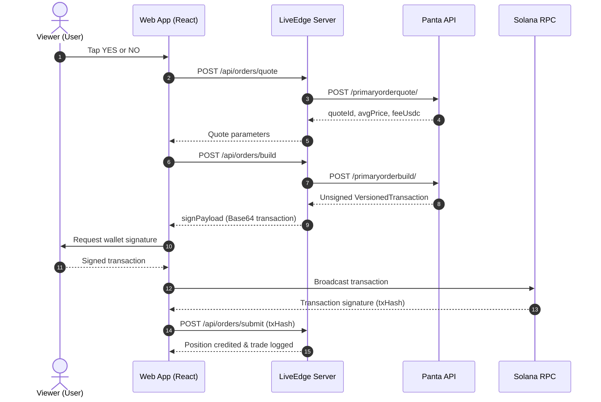
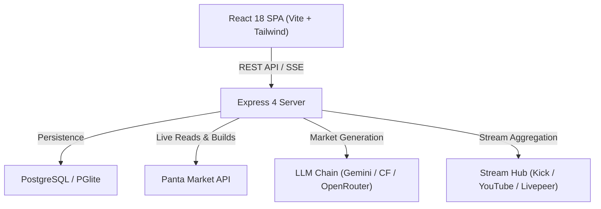

# LiveEdge

> Instant prediction markets for live streams powered by Panta.

[](https://nodejs.org/)
[](https://pnpm.io/)
[](https://solana.com/)
[](https://docs.panta.market/)

---

## Hero

<!-- TODO(owner): add production demo URL (e.g., https://liveedge.app) -->
<!-- TODO(owner): add demo video URL (e.g., Loom / YouTube link) -->
<!-- TODO(owner): add dashboard screenshot / GIF asset -->

```
[ Live Demo ] ─── <!-- TODO(owner): insert live demo link -->
[ Walkthrough Video ] ─── <!-- TODO(owner): insert video link -->
```

---

## The Problem and the Idea

Live-stream chats are filled with debate, speculation, and arguments over live outcomes ("Will he defeat the boss on this attempt?", "Does this raid wipe in phase 2?"). Viewers participate with fleeting chat comments, while creators receive little direct monetization from viewer consensus.

LiveEdge transforms that live chat energy into real-time prediction markets. A streamer or the automated engine launches a binary YES/NO market based on live stream events. Viewers take positions in a single tap, market odds adjust in real time alongside the video feed, and winners claim their payouts upon market resolution while creators earn volume-based fees.

---

## How It Works

1. **Market Creation**: A creator or automated broadcast engine launches a question tied to the active stream.
2. **Instant Bet**: Viewers choose YES or NO with play money (`sim_usdc`).
3. **Dynamic Odds**: Prices update in real time via an LMSR market-maker curve alongside the live video.
4. **Outcome Resolution**: The market resolves once the outcome occurs.
5. **Settlement & Claims**: Winning positions claim payouts, and creators claim earned fees.

### Non-Custodial Panta Custody & Order Flow

Panta operates non-custodially: Panta returns unsigned Solana transactions, the user signs via their own wallet, the client broadcasts to an RPC, and the transaction signature is submitted back for verification.



*Note: In Door 1 mode (`sim` and `hybrid`), settlement runs against an in-app simulated balance (`sim_usdc`), avoiding mainnet financial risk while preserving the exact Panta transaction and quote flow.*

---

## Panta API Integration

LiveEdge integrates the Panta Prediction Market API ([docs.panta.market](https://docs.panta.market/)) under the **Door 1** paradigm: real market data and real Panta API contract shapes coupled with simulated settlement.

### Integration Truth Table

| Panta Capability | LiveEdge Implementation | Mode Support | Source File |
| :--- | :--- | :--- | :--- |
| **Market Catalog & Detail** | Fetches live market batches (`GET /markets/`) and market details (`GET /markets/{id}/`) | **HYBRID / LIVE** (Real)<br>**SIM** (Simulated) | [server/src/panta/liveClient.js](file:///server/src/panta/liveClient.js)<br>[server/src/services/pantaSync.js](file:///server/src/services/pantaSync.js) |
| **Real-Time Prices & Quotes** | Syncs primary market prices; requests quotes (`POST /primaryorderquote/`) | **HYBRID / LIVE** (Real)<br>**SIM** (Simulated) | [server/src/panta/liveClient.js](file:///server/src/panta/liveClient.js)<br>[server/src/panta/hybrid.js](file:///server/src/panta/hybrid.js) |
| **Market Creation Quotes & Build** | Requests fee quote (`POST /markets/create/quote/`) and builds creation tx (`POST /markets/create/build/`) | **HYBRID / LIVE** (Real preview)<br>**SIM** (Simulated) | [server/src/panta/liveClient.js](file:///server/src/panta/liveClient.js)<br>[server/src/panta/hybrid.js](file:///server/src/panta/hybrid.js) |
| **Primary Buy Order Build** | Constructs unsigned Solana `VersionedTransaction` (`POST /primaryorderbuild/`) | **HYBRID / LIVE** (Real build)<br>**SIM** (Simulated) | [server/src/panta/liveClient.js](file:///server/src/panta/liveClient.js)<br>[server/src/panta/hybrid.js](file:///server/src/panta/hybrid.js) |
| **Wallet Positions** | Queries active positions (`GET /positions/?wallet=`) | **HYBRID / LIVE** (Real query)<br>**SIM** (Simulated) | [server/src/panta/liveClient.js](file:///server/src/panta/liveClient.js)<br>[server/src/panta/hybrid.js](file:///server/src/panta/hybrid.js) |
| **Trade Tape / Activity** | Reads historical trade records (`GET /markets/{id}/trades/`) | **HYBRID / LIVE** (Real reads)<br>**SIM** (Local tape) | [server/src/panta/liveClient.js](file:///server/src/panta/liveClient.js) |
| **Order Settlement & Execution** | Settle buy orders into `sim_usdc` balances | **SIMULATED** | [server/src/panta/simClient.js](file:///server/src/panta/simClient.js) |
| **Win Claims** | Verify eligibility and credit winning positions in `sim_usdc` | **SIMULATED** | [server/src/panta/simClient.js](file:///server/src/panta/simClient.js) |
| **Creator Fee Claims** | Release volume-graduated creator fees into creator balance | **SIMULATED** | [server/src/panta/simClient.js](file:///server/src/panta/simClient.js) |

---

## Features

- **Live Stream Prediction Hub**: Synchronized video embeds (Kick primary, YouTube fallback) alongside live betting boards.
- **Logarithmic Market Scoring Rule (LMSR)**: Automated market-maker algorithm providing bounded liquidity and continuous price discovery.
- **AI Broadcast Market Engine**: Auto-generates contextual prediction markets from live broadcast data using a resilient provider chain (Gemini with Cloudflare Workers AI and OpenRouter failover).
- **Opening Line Priors**: Gemini supplies an informed initial probability distribution $\pi_y$, setting an executable opening price without distorting LMSR invariant math.
- **Real-Time Data Streaming**: Server-Sent Events (SSE) push odds updates and trade tape feeds without client polling.
- **Dual Wallet & Auth Support**: Ephemeral Ed25519 guest keypairs for instant trial, plus Privy authentication for persistent profiles.

---

## The Three Pillars

1. **Honesty**: No synthetic views, fake streamers, or fabricated activity. When external feeds or market data are unreachable, the UI marks them as empty or stale rather than displaying generated data.
2. **Play Money Only (Panta Door 1)**: Real outcomes with simulated settlement. Accounts operate with `sim_usdc` (zero cash value) to enable frictionless entertainment and regulatory clarity.
3. **Money Conservation**: The internal ledger adheres to strict double-entry conservation verified down to integer micro-units ($10^{-6}$):

$$\sum \text{Balances} + \text{HouseEquity} \equiv \sum \text{Minted}$$

$$\text{HouseEquity} = \text{CreateFees} + \text{Buys} - \text{Claims} - \text{CreatorFeeClaims}$$

This rule is enforced by [server/test/invariant.test.js](file:///server/test/invariant.test.js).

---

## Architecture



### Repository Layout

```
.
├── docs/                 # Specifications, architecture, and guides
├── scripts/              # Dev server runner, smoke tests, security checks
├── server/
│   ├── src/              # Express backend, LMSR engine, Panta client, routes
│   └── test/             # node:test test suite and invariant tests
└── web/
    ├── public/           # Static assets
    └── src/              # React frontend (components, pages, lib, hooks)
```

---

## Pricing in 6 Lines

- Hanson's Logarithmic Market Scoring Rule (LMSR) determines prices: $p_{\text{yes}} = \frac{1}{1 + e^{-(q_y - q_n)/b}}$.
- Opening lines incorporate an initial prior $\pi_y$ via quantity shift: $C_{\text{prior}}(q) = C_{\text{uniform}}(q + b \ln \pi)$.
- At $q = 0$, the market opens exactly at the probability supplied by the engine ($\pi_y$).
- The displayed price directly matches the execution price for incoming orders.
- Worst-case subsidy is bounded at $b \ln(1 / \min(\pi_y, \pi_n))$.
- If the AI engine is unavailable, the market degrades safely to a neutral $0.50$ opening line.

---

## Quick Start

### Prerequisites
- Node.js 20+ (`node -v`)
- pnpm 9.12+ (`corepack enable` or `npm install -g pnpm`)

### Setup and Execution

1. Clone repository and install dependencies:
   ```bash
   pnpm install
   ```

2. Configure environment:
   ```bash
   # PowerShell
   Copy-Item .env.example .env

   # Bash
   cp .env.example .env
   ```

3. Launch development servers:
   ```bash
   pnpm dev
   ```

4. Verify instances:
   - Web interface: [http://localhost:5173](http://localhost:5173)
   - API endpoints: [http://localhost:4000/health](http://localhost:4000/health)

---

## Configuration

| Environment Variable | Purpose | Default | Required Mode |
| :--- | :--- | :--- | :--- |
| `NODE_ENV` | Runtime environment (`development`, `test`, `production`) | `development` | All |
| `PORT` | API server listen port | `4000` | All |
| `DATABASE_URL` | PostgreSQL connection string (uses embedded PGlite if unset) | `""` | Production |
| `JWT_SECRET` | Session authentication secret (min 32 chars) | dev placeholder | Production |
| `PANTA_MODE` | Integration mode: `sim`, `hybrid`, `live` | `sim` | All |
| `PANTA_BASE_URL` | Panta API endpoint | `https://live-api.panta.market/api/v1` | All |
| `PANTA_API_KEY` | Panta API authentication key | `""` | Hybrid, Live |
| `PANTA_REALTIME_ENABLED` | Enables live Panta market background polling | `false` | Hybrid (optional) |
| `KICK_CLIENT_ID` | Kick Developer Client ID | `""` | Stream browsing |
| `KICK_CLIENT_SECRET` | Kick Developer Client Secret | `""` | Stream browsing |
| `YOUTUBE_API_KEY` | Google Cloud API Key for YouTube Live search | `""` | YouTube streams |
| `GEMINI_API_KEY` | Google Gemini API key for automated market engine | `""` | AI engine |
| `PRIVY_APP_ID` | Privy Application ID for wallet authentication | `""` | Privy auth |
| `PRIVY_APP_SECRET` | Privy App Secret (server-side only) | `""` | Privy auth |

---

## Modes

| Mode | Panta Reads | Trades & Claims | Key Required | Target Audience |
| :--- | :--- | :--- | :--- | :--- |
| **`sim`** *(default)* | Simulated DB | Local `sim_usdc` simulation | No | Local development, CI testing |
| **`hybrid`** | Real Panta API | Local `sim_usdc` simulation | Yes (`PANTA_API_KEY`) | Demo preview with real market data |
| **`live`** | Real Panta API | Panta API / chain execution | Yes (API Key + Funded Wallet) | Full production |

---

## Scripts and Testing

Run the standard test gates from the repository root:

```bash
pnpm test           # Runs all server and web test suites
pnpm build          # Builds production bundle
pnpm lint           # Runs ESLint analysis across workspace
pnpm check-secrets  # Scans repository for leaked credentials
pnpm smoke          # Executes end-to-end user lifecycle smoke test
```

### Verified Baseline Test Numbers

- **Server Unit & Route Tests**: 431 passed, 94 suites (`node --test`)
- **Web Frontend Tests**: 181 passed, 16 test files (`vitest run`)
- **Money Invariant Test**: 3 passed, 1 suite (`node --test test/invariant.test.js`)
- **E2E Smoke Verification**: 26 passed (`scripts/smoke.mjs`)
- **Build**: 0 errors
- **Linter**: 0 errors (1 warning)
- **Secrets Audit**: Passed (`scripts/check-secrets.mjs`)

---

## Honest Limitations

- **Play Money Only**: LiveEdge balances use `sim_usdc` with zero cash value. It is not an exchange or real-money wagering application.
- **Simulated Settlement**: In `sim` and `hybrid` modes, resolution and claims are handled by internal simulator logic rather than on-chain settlement contracts.
- **Provider Degradation**: When external services (Gemini, Kick, YouTube) are offline or unconfigured, LiveEdge degrades gracefully to cached data, flat 50/50 opening lines, or curated feeds.

---

## Roadmap

1. **On-Chain Settlement Bridge**: Graduate high-volume play-money markets into direct Panta Solana contracts.
2. **Creator Dashboard**: Expanded real-time analytics for streamers to monitor market engagement and fee distributions.
3. **Automated Outcome Oracles**: Stream video multi-modal recognition for instant event verification and automated resolution.

---

## Hackathon Submission

This project is submitted to the **Colosseum Crypto World's Fair** and specifically targets the **Panta API Sidetrack** on Superteam Earn.

### Judging Criteria Mapping

| Criterion | Implementation in LiveEdge |
| :--- | :--- |
| **Panta API Integration** | Direct utilization of Panta's catalog, quote, transaction builder, and positions endpoints ([server/src/panta/liveClient.js](file:///server/src/panta/liveClient.js)). |
| **Technical Execution** | Monorepo architecture with mathematically verified LMSR pricing curves and integer micro-unit money conservation invariants. |
| **Product & UX** | Live streaming interface allowing one-tap market participation beside live video with real-time SSE odds updates. |
| **Originality** | Blends live stream creator tools with automated LLM-generated prediction markets and opening-line prior pricing. |
| **Impact Potential** | Introduces audience-driven monetization for streamers without requiring audience risk capital. |
| **Traction** | Fully working interactive prototype with zero-setup local storage (PGlite) and end-to-end automated smoke validation. |

### Team
- **GitHub**: [sidneycodes1](https://github.com/sidneycodes1)
- **X**: [@Sidney_codes](https://x.com/Sidney_codes)

---

## License

*(License unassigned — refer to repository owner).*
